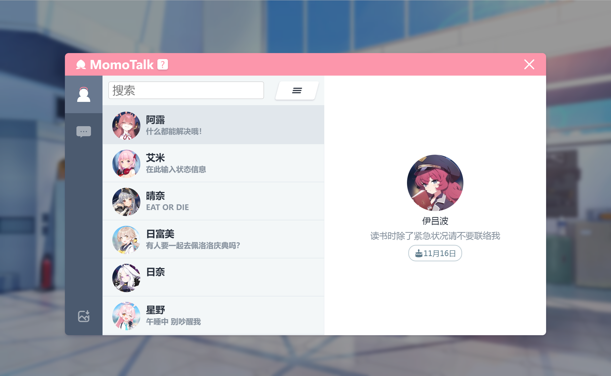
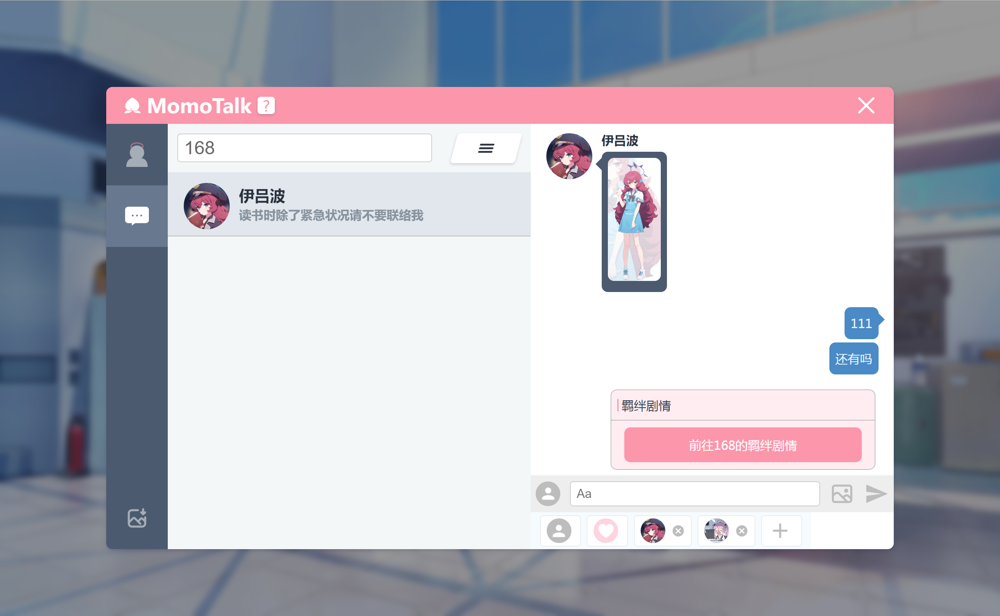

<h1 align="center">Momotalk Editor</h1>

    
    
    

  <strong>A web chat generator, style from Blue Archive</strong> 
  Set your Creative Idea free!

[中文说明](./README-zh.md)

## Feature

- **Searchable**: search students by names, romajis, and even nicknames. 🔍️
- **Custom role**: chat as Students, Sensei, and Custom roles. 🎅
- **Story Event**: send Images/Story Event during the chat. ❤️
- **Flexible Editor**: the chat box can be Inserted, Editted, Deleted, Dragged. 👍
- **Easy to Share**: save the conversation as an image and share your friends. 🖼️

[Try it!](https://u1805.github.io/momotalk)

## Preview

## Star History

## Credits

This project is inspired by:

- [Yuzutalk](https://www.yuzutalk.net/)
- [Slouchwind/momotalk-editor](https://github.com/Slouchwind/momotalk-editor)
- [blacktunes/juus-maker](https://github.com/blacktunes/juus-maker)
- [ClosureTalk/closure-talk](https://github.com/ClosureTalk/closure-talk)

Character metadate from:

- [lonqie/SchaleDB](https://github.com/lonqie/SchaleDB)
- [Ba.Gamekee](https://ba.gamekee.com/)

## Copyrights

Blue Archive avatar and stamp copyrights belong to Yostar & NEXON Games